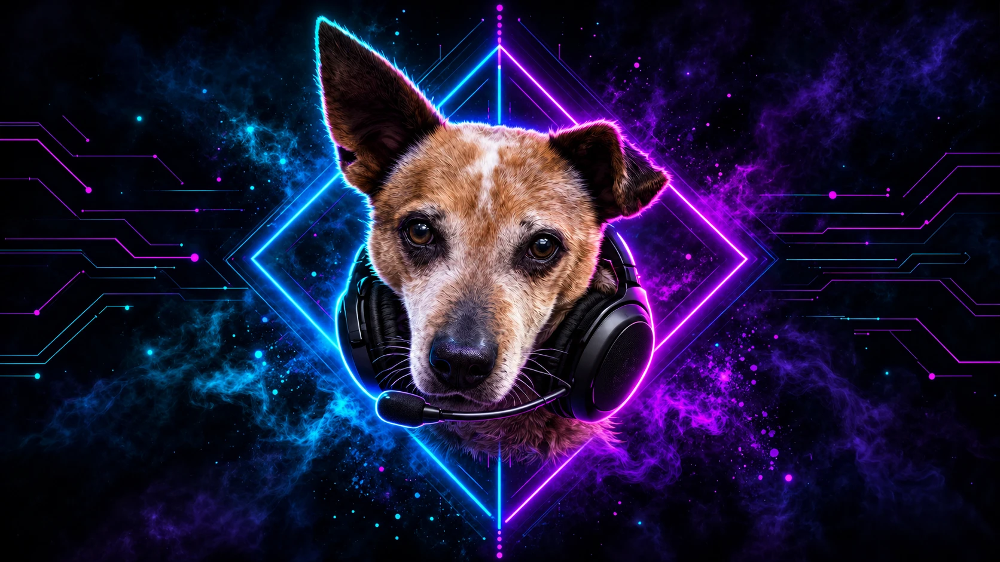

# 🌈 Neon Hyprland Dotfiles

<div align="center">


*A cyberpunk-inspired Hyprland rice with neon aesthetics and smooth animations*

• [Features](#-features) • [Installation](#-installation) • [Keybindings](#%EF%B8%8F-keybindings) • [Customization](#-customization)



</div>

---

## ✨ Features

### 🎨 **Neon Aesthetic**
- Cyberpunk-inspired color scheme with glowing magenta borders
- Custom neon pill-style Waybar
- Neon login screen (SDDM) and lock screen (hyprlock)
- Smooth animations, blur and semi-transparent windows

### 🖥️ **Components**
- **Window Manager**: Hyprland, configured in **Lua** (master layout)
- **Status Bar**: Waybar (custom neon theme)
- **Terminal**: Kitty
- **Shell**: Zsh with Spaceship prompt
- **Login Screen**: SDDM with the custom `neon` theme
- **Lock Screen**: hyprlock
- **Sleep Timer**: hypridle
- **Wallpaper**: swaybg
- **Font**: IBM Plex Mono

### 💤 **Sleep Timer**

| Idle for | What happens |
|----------|--------------|
| 9 min  | Notification: locking in 1 minute |
| 10 min | Lock screen |
| 11 min | Monitors off |
| 30 min | Suspend |

Fullscreen windows (games, videos) pause the timer. Edit the timeouts in `hypr/hypridle.conf`.

### 📊 **System Monitor in Waybar**
- **CPU** and **GPU** pills show live usage and temperature (e.g. `23% 54°C`)
- CPU tooltip shows the Ryzen core-die (CCD) temperature too
- Pills turn hot pink when running hot: GPU at 80°C edge or within 10°C of its throttle point, CPU at 90°C
- Click the GPU pill for `nvtop`, or the CPU/memory pill for `btop`
- **Memory** pill shows RAM in use
- **Updates** pill shows how many updates are waiting (✓ when up to date); click it to update
- Hover any pill for details: clock speed, VRAM, power draw, top processes
- Works with AMD (edge, hotspot and VRAM temps, fan speed, power limit) and NVIDIA cards
- On Ryzen systems it reads the graphics card, not the CPU's built-in graphics

### 🎮 **Gaming (Steam)**
- Steam games are fully solid: no transparency, blur, shadow or dimming
- Screen tearing allowed for games, for lower input lag
- VRR (FreeSync / G-Sync) on fullscreen windows
- Games open on workspace 5, on the main monitor
- **`SUPER + G` game mode** turns off animations, blur, gaps and transparency everywhere; press again to restore
- Installs `steam`, `gamemode`, `mangohud` and `gamescope`, and enables the multilib repo

In Steam, right-click a game → **Properties** → **Launch Options** and paste:

```
gamemoderun mangohud %command%
```

### 🧊 **3D Art**
- Blender is fully solid with no dimming, so colors look right
- Blender's preferences, render and file-browser windows float instead of tiling

---

## 🎨 Color Palette

Sampled from the wallpaper. Waybar defines these once at the top of `waybar/style.css`.

| Element | Hex Code |
|---------|----------|
| **Cyan** (workspaces, clock, network) | `#31e4f6` |
| **Sky blue** (updates, audio) | `#1ab9ef` |
| **Blue** (memory) | `#3d7bff` |
| **Violet** (CPU) | `#8f5bff` |
| **Purple** (GPU) | `#b44cff` |
| **Pink** (window title, alerts) | `#ff2bd6` |
| **Magenta** (window borders) | `#ff00ff` |
| **Background** | `#030310` |

---

## 📦 What's Included

```
dotfiles/
├── hypr/
│   ├── hyprland.lua          # Entry point, loads config/*
│   ├── config/
│   │   ├── variables.lua     # Programs and mainMod
│   │   ├── monitors.lua
│   │   ├── environment.lua
│   │   ├── aesthetics.lua    # Gaps, borders, blur, animations, layouts
│   │   ├── input.lua
│   │   ├── autostart.lua
│   │   ├── keybindings.lua
│   │   ├── window-rules.lua
│   │   └── gaming.lua        # Steam rules, tearing, VRR, game mode
│   ├── hypridle.conf         # Sleep timer
│   ├── hyprlock.conf         # Lock screen
│   └── scripts/
│       ├── wallpaper.sh      # Sets the wallpaper (swaybg)
│       └── show-keybindings.sh
├── waybar/                   # Bar layout and neon style
├── kitty/                    # Terminal config
├── sddm/neon/                # Neon login screen theme
├── wallpapers/default.png    # Default desktop wallpaper
├── scripts/
│   ├── install-sddm.sh       # Installs the neon login screen
│   ├── nvidia.sh             # NVIDIA drivers + Hyprland env (NVIDIA only)
│   ├── update.sh             # Pulls this repo and updates packages
│   └── waybar/               # Waybar module scripts
├── packages.txt              # Everything install.sh installs
├── install.sh                # The installer
└── .zshrc
```

---

## 🚀 Installation

### Prerequisites
- Arch Linux (or an Arch-based distro)
- Hyprland **0.55 or newer** (the config is Lua)
- A normal user with sudo

### Install

```bash
git clone https://github.com/whiskeydevil91/dotfiles.git ~/dotfiles
cd ~/dotfiles
./install.sh
```

The installer:
1. Installs everything in `packages.txt` with `paru` (installs paru first if needed)
2. Moves your existing `hypr`, `waybar`, `kitty` configs and `.zshrc` to `~/.config-backup-<date>`
3. Copies the new configs into `~/.config`
4. Installs the wallpaper to `~/Pictures/Wallpapers/default.png`
5. Links `~/hyprdots` to the repo, where Waybar's scripts live
6. Installs CPU microcode (`amd-ucode` or `intel-ucode`)
7. Detects your GPU:
   - **AMD**: installs Mesa and the Vulkan drivers (64- and 32-bit, for Steam), and offers HIP so Blender can render on the GPU
   - **NVIDIA**: offers `scripts/nvidia.sh`
8. Asks whether to install the neon SDDM login screen

Then reboot and pick **Hyprland** on the login screen.

---

## ⌨️ Keybindings

Press **`SUPER + /`** (or `SUPER + F1`) to see every keybinding. The list is read live from Hyprland, so it's never out of date.

| Keybinding | Action |
|------------|--------|
| `SUPER + Return` | Terminal |
| `SUPER + SPACE` | App launcher (rofi) |
| `SUPER + W` | Browser |
| `SUPER + E` | File manager |
| `SUPER + T` | Code editor |
| `SUPER + Q` | Close window |
| `SUPER + F` | Toggle floating |
| `ALT + F` | Toggle fullscreen |
| `SUPER + ALT + SPACE` | Switch master / dwindle layout |
| `SUPER + G` | Toggle game mode |
| `SUPER + L` | Lock screen |
| `SUPER + DELETE` | Exit Hyprland |
| `SUPER + ←/↓/↑/→` | Move focus |
| `SUPER + SHIFT + ←/↓/↑/→` | Move window |
| `SUPER + 1-0` | Go to workspace 1-10 |
| `SUPER + SHIFT + 1-0` | Move window to workspace 1-10 |
| `SUPER + S` | Toggle scratchpad |
| `Print` | Screenshot region |
| `SUPER + P` | Screenshot region to clipboard |

---

## 🎨 Customization

All Hyprland settings are Lua files in `~/.config/hypr/config/`. Hyprland reloads them automatically when you save.

### Apps and Modifier Key

Edit `config/variables.lua`:

```lua
return {
    mainMod  = "SUPER",
    terminal = "kitty",
    browser  = "zen-browser",
    ...
}
```

### Border Colors and Transparency

Edit `config/aesthetics.lua`:

```lua
general = {
    col = {
        active_border   = { colors = { "rgba(ff00ffff)", "rgba(ff1493ff)" }, angle = 45 },
        inactive_border = "rgba(8b008baa)",
    },
},
decoration = {
    active_opacity   = 0.75,
    inactive_opacity = 0.65,
},
```

### Monitors

Edit `config/monitors.lua`. Run `hyprctl monitors all` to see your monitor names:

```lua
hl.monitor({ output = "DP-2", mode = "3440x1440@60", position = "0x1080", scale = 1 })
```

### Wallpaper

```bash
# Switch to a different image
~/.config/hypr/scripts/wallpaper.sh /path/to/wallpaper.png

# Or make it the new default (also used by the lock screen)
cp /path/to/wallpaper.png ~/Pictures/Wallpapers/default.png
```

### Login Screen

The theme lives in `sddm/neon/`. Change colors in `theme.conf`, or replace `background.png`, then rerun `./scripts/install-sddm.sh`.
Preview it without logging out:

```bash
sddm-greeter-qt6 --test-mode --theme /usr/share/sddm/themes/neon
```

### Waybar Colors

Edit the `@define-color` lines at the top of `~/.config/waybar/style.css`, then restart Waybar.

---

## 🔧 Troubleshooting

### Config errors

Hyprland shows a red error bar for Lua errors. Each file in `config/` loads separately, so an error in one file doesn't break the others. Logs:

```bash
cat "$XDG_RUNTIME_DIR"/hypr/*/hyprland.log
```

### Waybar Not Showing

```bash
killall waybar; waybar -c ~/.config/waybar/config.json -s ~/.config/waybar/style.css &
```

### Login Screen Not Applied

```bash
cat /etc/sddm.conf.d/theme.conf   # should show Current=neon
```

### Waybar Scripts Not Working

```bash
ls -l ~/hyprdots   # should point at your dotfiles clone
```

---

## 🤝 Contributing

Contributions, issues, and feature requests are welcome!

1. Fork the repository
2. Create your feature branch (`git checkout -b feature/AmazingFeature`)
3. Commit your changes (`git commit -m 'Add some AmazingFeature'`)
4. Push to the branch (`git push origin feature/AmazingFeature`)
5. Open a Pull Request

---

## 📝 License

This project is licensed under the MIT License - see the [LICENSE](LICENSE) file for details.

---

## 💖 Acknowledgments

- [Hyprland](https://hyprland.org/) - Amazing Wayland compositor
- [Waybar](https://github.com/Alexays/Waybar) - Customizable status bar
- [IBM Plex](https://github.com/IBM/plex) - Excellent monospace font
- The Hyprland community for inspiration

---

## 📧 Contact

**whiskeydevil91** - [@whiskeydevil91](https://github.com/whiskeydevil91)

Project Link: [https://github.com/whiskeydevil91/dotfiles](https://github.com/whiskeydevil91/dotfiles)

---

<div align="center">

### ⭐ If you like this rice, please star the repo! ⭐

Made with 💜 and lots of ☕

</div>
